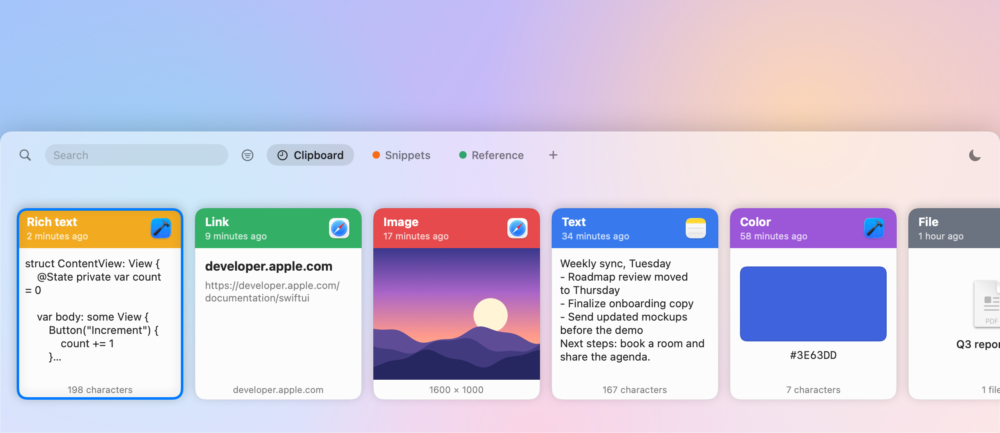
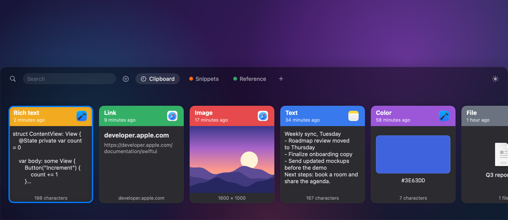
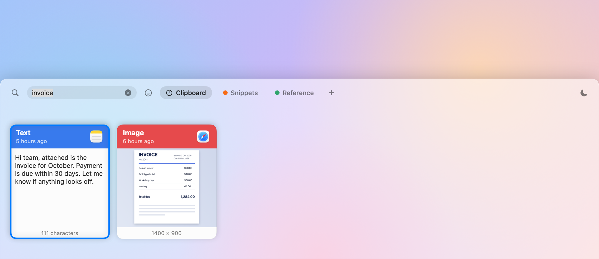
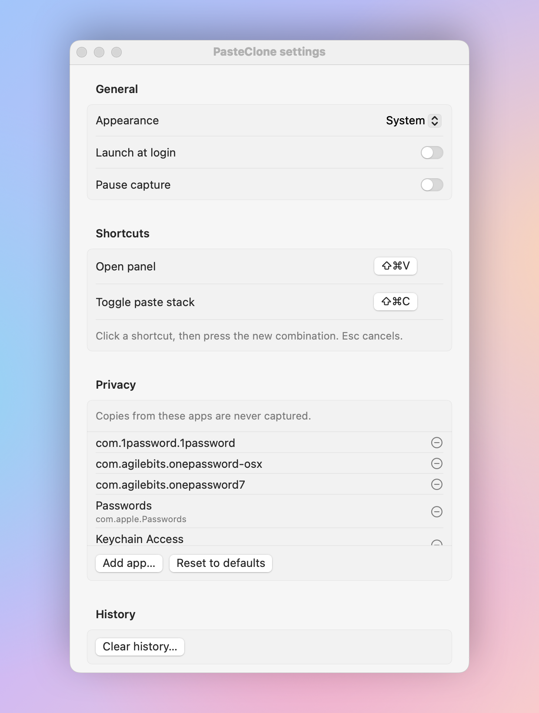

# CommandV

A clipboard manager for macOS. Everything you copy is saved, searchable and one shortcut away.





## Features

* Unlimited history of text, links, rich text, images and files
* Instant search, including the text inside screenshots
* Filters by type and by the app a clip came from
* Pinboards for the clips you reuse
* Paste stack: copy several things, then paste them in order
* Drag a card into any app, or onto a pinboard tab to keep it
* Light and dark mode
* Password managers are ignored by default
* Everything stays on your Mac



## How it works

CommandV runs in the menu bar and watches the system pasteboard. 
Each copy is saved to a local SQLite database together with the app it came from. Images are stored on disk with a thumbnail, and their text is read on your Mac with Apple's Vision framework, then added to a full text index so a screenshot can be found by the words in it.

Press ⇧⌘V and a panel slides up along the bottom of the screen. Pick a card with the arrow keys or the mouse and press Return. CommandV puts the clip back on the clipboard, returns to the app you were using and sends ⌘V for you. Hold Shift while pressing Return to paste plain text.

Copies from excluded apps, and anything an app marks as concealed, are never saved. You can edit the excluded list in Settings.



## Shortcuts

* ⇧⌘V opens and closes the panel
* ⇧⌘C starts and stops the paste stack, and ⇧⌘V pastes the next item while it runs
* Arrow keys move, Return pastes, Shift Return pastes plain text, Delete removes a clip, Esc clears the search and then closes the panel

Both global shortcuts can be changed in Settings.

## Build

Requires macOS 14 or later and Xcode.

```
swift build
swift test
scripts/bundle.sh
open build/CommandV.app
```

To paste for you, CommandV needs Accessibility access: System Settings, Privacy and Security, Accessibility. Without it, clips are still copied and you press ⌘V yourself. The app is signed ad hoc, so after a rebuild macOS may ask you to grant access again.

## Limits

* Text over 1 MB is shortened when pasted back
* No iCloud sync and no iOS app
